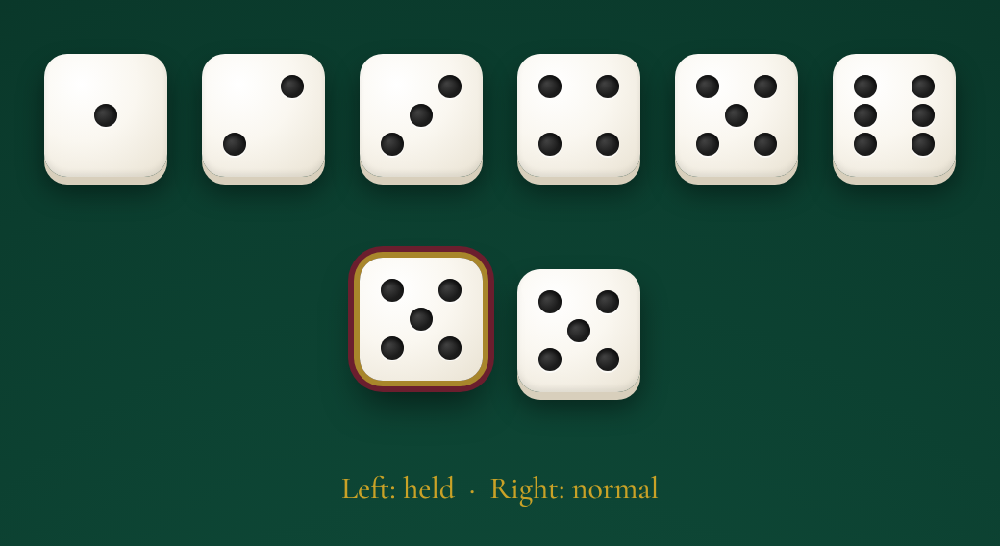
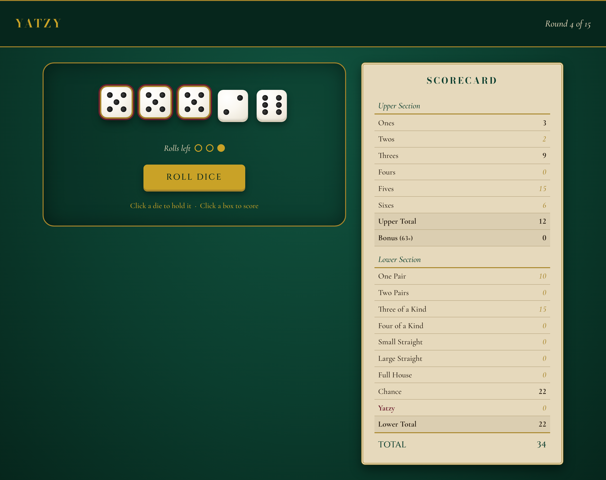
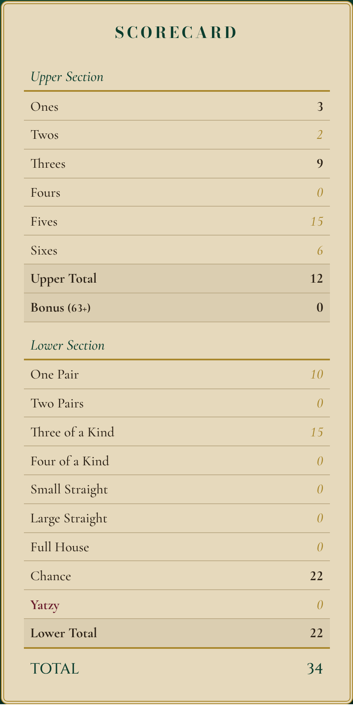
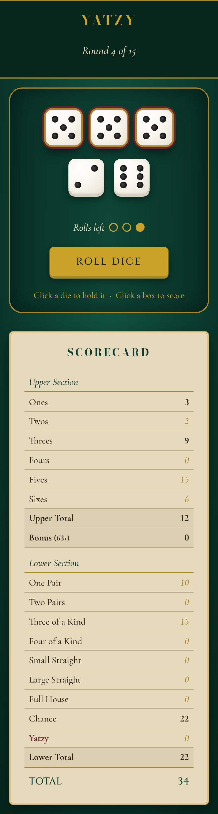

# Yatzy Game Design Documentation

This document is the design system for my Yatzy game: the rules, colours, typography, dice design and HTML/CSS mock-ups that the game will be built from in the later labs.

**Design direction:** a high-end casino table. Deep green felt, ivory dice, and gold accents used sparingly. The game should feel calm and premium.

---

## 1. Game Overview

Yatzy is a dice game that mixes luck and strategy. The player rolls five dice to make combinations, and each combination scores in one box on the scorecard. There are 15 boxes on the scorecard, so a game lasts 15 rounds. The goal is to finish with the highest total score.

## 2. Rules

### Turns

- On each turn, the player can roll the dice **up to three times**.
- After each roll, the player can **hold** any dice and re-roll the rest.
- After the last roll (or earlier, if they choose), the player **must** score the dice in one empty box on the scorecard. If the dice don't fit any combination, they score 0 in a box of their choice.
- Each box can only be used once.

### Upper Section

| Box | Score |
| --- | ----- |
| Ones - Sixes | Sum of the dice showing that number |
| **Bonus** | **+50** if the upper section totals 63 or more |

### Lower Section

| Box | Requirement | Score |
| --- | ----------- | ----- |
| One Pair | Two dice the same | Sum of the pair |
| Two Pairs | Two different pairs | Sum of both pairs |
| Three of a Kind | Three dice the same | Sum of those three |
| Four of a Kind | Four dice the same | Sum of those four |
| Small Straight | 1-2-3-4-5 | 15 |
| Large Straight | 2-3-4-5-6 | 20 |
| Full House | A three of a kind plus a pair | Sum of all dice |
| Chance | Anything | Sum of all dice |
| Yatzy | All five dice the same | 50 |

### End of Game

The game ends when all 15 boxes are filled. The final score is the upper section, plus the bonus, plus the lower section.

---

## 3. Design System

### Colour Palette

All colours are defined once as CSS custom properties (design tokens) in `:root` and used everywhere through `var()`, so the whole theme can be adjusted from one place.

#### Primary Colours: the Table

| Token | Hex | Role |
| --- | --- | --- |
| `--color-felt` | `#0B3D2E` | Deep emerald. The main game board (the felt table). |
| `--color-felt-dark` | `#06261C` | Near-black green. Table edge, header bar and the text on gold buttons. |
| `--color-ivory` | `#FAF7F0` | Dice faces. The brightest thing on the screen, so the eye goes to the dice first. |
| `--color-pip` | `#1C1C1C` | Charcoal. The dots (pips) on the dice. |

#### Secondary Colours: Accents and the Scorecard

| Token | Hex | Role |
| --- | --- | --- |
| `--color-gold` | `#C9A227` | Muted gold. Game title and the Roll button. |
| `--color-brass` | `#A8862B` | Antique brass. Scorecard border and dividers. |
| `--color-oxblood` | `#6B1E2E` | Deep burgundy. Highlights held dice and the Yatzy row. |
| `--color-parchment` | `#E6D9BC` | Aged parchment. Scorecard background. |
| `--color-ink` | `#2E2418` | Sepia ink. Scorecard text. |
| `--color-rule` | `#BFAE8A` | Faded tan. Lines between scorecard rows. |

#### Why These Colours

- **High-end casino feel.** Green felt, ivory dice and gold trim are what people picture at a real casino table. Keeping the gold muted (instead of a bright yellow) makes it feel expensive instead of flashy.
- **Aged scorecard.** Aged parchment with sepia ink and brass trim looks like an old ledger. It's softer against the dark felt than a bright white or cream would be, so it's easier on the eyes.
- **Clear hierarchy.** The ivory dice are the brightest element, the parchment scorecard is second, and the felt stays in the background. The player's attention goes where the action is.
- **Oxblood for state.** Held dice and the Yatzy row need to stand out without breaking the theme. A deep burgundy fits the casino look better than a typical bright red or blue.

### Typography

Three fonts, each with one job. All are free on Google Fonts.

| Use | Font | Fallback | Style |
| --- | --- | --- | --- |
| **Display** (YATZY title, SCORECARD heading) | Bodoni Moda | Georgia, serif | Uppercase, letter-spaced, gold or felt green |
| **Interface headings** (Roll button, TOTAL) | Cinzel | Georgia, serif | Uppercase, letter-spaced |
| **Subheadings** (round status, section labels, rolls left) | Cormorant Garamond | Georgia, serif | Italic |
| **Body text and scores** | Cormorant Garamond | Georgia, serif | Regular (500), with `font-variant-numeric: lining-nums tabular-nums` |

#### Why These Fonts

- **Bodoni Moda** is a high-contrast "Didone" serif, the style used by luxury fashion houses and old European casinos. It's the most "old money" of the fonts, so it's saved for the two most important titles.
- **Cinzel** is based on classic Roman inscriptions. Its engraved capitals stay sturdy and readable at small sizes, so it handles the interface: the Roll button and TOTAL.
- **Cormorant Garamond** is an elegant classical serif used for everything else: italic for subheadings, regular for the scorecard and instructions. It keeps the whole game in one classic style instead of mixing in a modern sans-serif.
- **Why not one font?** Bodoni Moda and Cinzel are both capitals-focused display fonts, and Cinzel has no real lowercase, so neither works for body text. Pairing a contrasting display font with a readable text font gives a clear hierarchy.
- **Numbers:** Cormorant's default "old-style" digits move up and down like lowercase letters. `lining-nums` makes every digit the same height, and `tabular-nums` makes them the same width, so the score column lines up.
- **Design iteration:** the first version used Cinzel for every heading and Inter for body text. Bodoni Moda gave the title a more luxurious feel, and replacing Inter with Cormorant removed the one modern-looking font from an otherwise classic design.

---

## 4. Dice Design

### Size and Shape
- Each die is **4rem (64px)** square with **12px rounded corners**.
- The size comes from one token, `--die-size`, so every die can be resized from one place.

### Colour and Texture
- **Face:** ivory (`--color-ivory`) with a soft radial gradient.
- **Depth:** a solid lower edge gives the die thickness, and a soft drop shadow makes it look like it's sitting on felt.

### Pips
- Pips are **0.75rem charcoal circles** (`--color-pip`).
- An inset shadow makes each pip look **drilled into** the die.
- Each die is a **3x3 CSS grid**. Every pip is placed in one of the nine cells, so each face (1-6) is just a different set of cells. This allows easier manipulation of faces with JavaScript later.

### States
| State | Look |
| --- | --- |
| Normal | Resting on the felt |
| Hover | Lifts slightly (2px) to show the die is clickable |
| Held | Lifts 6px with a **brass ring** and an **oxblood outer ring**, so it's obvious which dice won't be re-rolled |

---

## 5. Game Mock-ups

The mock-ups are built in HTML/CSC (`mockup.html` + `mockup.css`) using the colour tokens and fonts from Section 3. The code is commented to explain each section.

### Game Board (Desktop)

### Scorecard

### Mobile

The mock-up shows round 4: the player has rolled twice, is holding three 5s, and has one roll left.

---

## 6. Layout, Flow and Interactions

### Layout
- **Header bar:** game title on the left, round status on the right.
- **Table (left, 3/5 of the width):** the five dice, rolls-left markers, the Roll button and a short hint.
- **Scorecard (right, 2/5 of the width):** upper section, bonus, lower section and totals.
- **Below 900px:** the scorecard stacks under the table and the dice wrap onto two rows.

### Game Flow
1. The player clicks **Roll Dice**. All dice that aren't held are rolled.
2. The player clicks dice to **hold** or release them, then rolls again (up to 3 rolls per turn).
3. The scorecard shows a **preview** (brass italic) of what the dice would score in each open box.
4. The player clicks an open box to **score** it. The number turns bold ink and the turn ends.
5. After 15 rounds, the totals and bonus are calculated and the final score is shown.

### Planned Interactions and Animations
| Element | Interaction |
| --- | --- |
| Die | Hover lifts it 2px; clicking toggles **held** (lifts 6px, brass + oxblood ring) |
| Roll button | Presses down when clicked; dice tumble briefly when rolled |
| Rolls left | A gold marker turns hollow after each roll |
| Open score box | Brass highlight on hover; clicking locks in the score |
| Scorecard | Totals and bonus update as boxes are filled |

### Implementation Notes
- **State classes:** `held`, `open`, `filled`, `preview` and `available` are plain CSS classes. The JavaScript phase adds and removes these classes to change how elements look.
- **Units:** sizes and spacing use `rem`; borders, radius and shadows use `px`.
- **Responsive:** a single media query at 900px switches the layout to one column.
