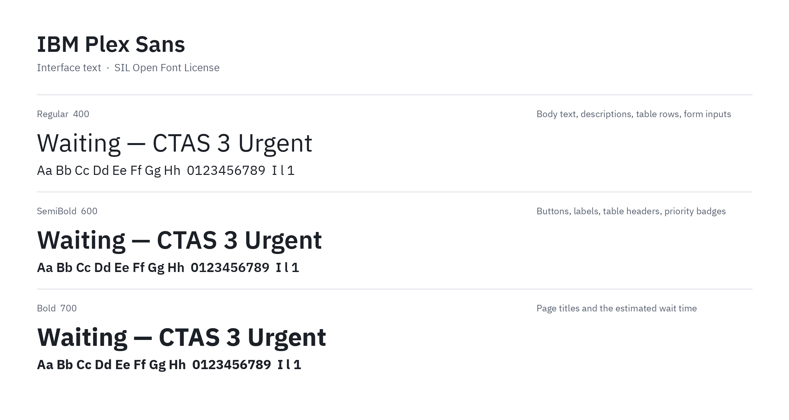
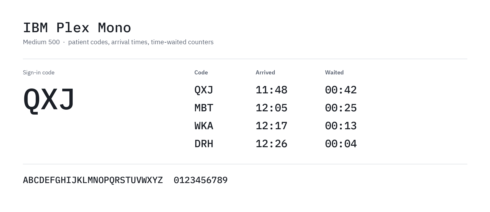
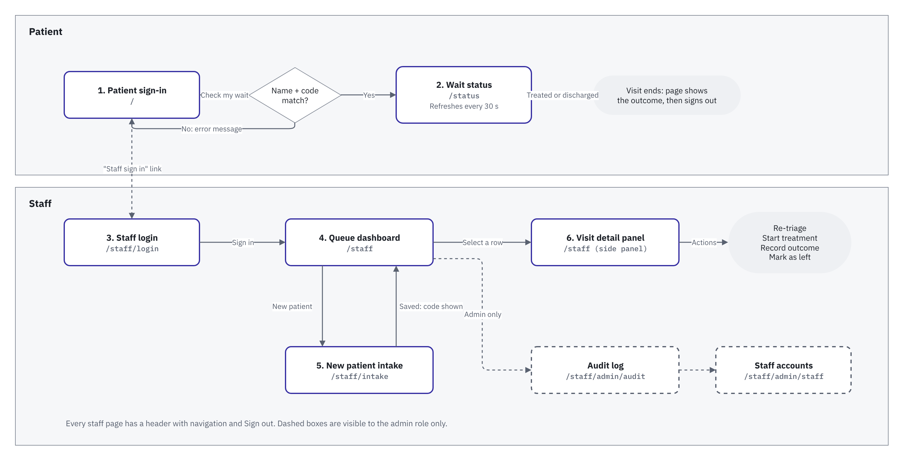

# Hospital Triage: Design System

This design document defines the visual and functional design of the Hospital Triage App. It is the reference for every screen and for the app's CSS so the patient and staff sides look and behave as one product.

Triage priority uses the five CTAS (Canadian Triage and Acuity Scale) levels, patients sign in with their last name and a 3-letter code, and staff sign in through a separate staff portal.

## Contents

1. [Fonts](#1-fonts)
2. [Colour Palette](#2-colour-palette)
3. [App Components](#3-app-components)
4. [Layout and Navigation](#4-layout-and-navigation)
5. [Consistency](#5-consistency)

---

## 1. Fonts

The app uses two fonts: **IBM Plex Sans** and **IBM Plex Mono**. Both are open source and were designed together so they pair cleanly.

### IBM Plex Sans



| Weight | Value | Used for |
| --- | --- | --- |
| Regular | 400 | Body text, descriptions, table rows, form inputs |
| SemiBold | 600 | Buttons, labels, table headers, priority badges |
| Bold | 700 | Page titles and the patient's estimated wait time |

### IBM Plex Mono



| Weight | Value | Used for |
| --- | --- | --- |
| Medium | 500 | 3-letter patient codes, arrival times, time-waited counters |

Every character in a monospace font is the same width. Codes are easier to read one letter at a time and to copy correctly, and times line up in a vertical column in the staff queue, so staff can compare waits at a glance.

### Type scale

| Token | Size | Used for |
| --- | --- | --- |
| `--text-sm` | 0.875rem (14px) | Helper text, timestamps, footnotes |
| `--text-base` | 1rem (16px) | Staff body text and tables |
| `--text-lg` | 1.125rem (18px) | Patient body text |
| `--text-xl` | 1.5rem (24px) | Section headings |
| `--text-2xl` | 2rem (32px) | Page titles |
| `--text-display` | 3rem (48px) | The patient's estimated wait time |

Line height is 1.5 for body text and 1.2 for headings.

### Why these fonts

- **Easy legibility.** Plex Sans has open letter shapes and clear differences between similar characters such as `I`, `l` and `1`, which reduces misreading.
- **Patients get larger text than staff.** Patient pages use a larger font size because patients usually check one piece of information, often on a phone. Staff pages use a slightly smaller font to fit more patients and information on screen.

If the fonts fail to load, the browser falls back to the system's own fonts:

```css
--font-sans: "IBM Plex Sans", system-ui, -apple-system, "Segoe UI", sans-serif;
--font-mono: "IBM Plex Mono", ui-monospace, "Consolas", monospace;
```

---

## 2. Colour Palette

The app uses neutral greys with one indigo accent colour. The CTAS colours are only used for triage priority.

### Base colours

| Name | Hex | Used for |
| --- | --- | --- |
| Background | `#F6F7F9` | Page background |
| Surface | `#FFFFFF` | Cards, tables, inputs |
| Border | `#818894` | Input borders |
| Text | `#1C2027` | Body text and headings |
| Muted text | `#596170` | Descriptions, helper text, timestamps |
| Primary | `#3730A3` | Buttons, links, focus outline |
| Primary tint | `#EEF0FF` | Selected row, "Waiting" tag |
| Error | `#B42318` | Error messages, "Over target" flag |

### CTAS colours (staff pages only)

| Level | Name | Hex | Target time |
| --- | --- | --- | --- |
| 1 | Resuscitation | `#1D4ED8` | Immediate |
| 2 | Emergent | `#B91C1C` | 15 min |
| 3 | Urgent | `#FACC15` | 30 min |
| 4 | Less Urgent | `#15803D` | 60 min |
| 5 | Non-Urgent | `#FFFFFF` (grey outline) | 120 min |

### Patient vs staff pages

- **Patient pages** use the base colours only.
- **Staff pages** use the base colours plus the CTAS colours.

### Why these colours

- **No clash with CTAS.** Blue, red, yellow and green are already used by CTAS, so the accent colour is indigo.
- **Standard CTAS colours.** These are the colours triage staff already use.
- **Colour is never the only signal.** Priority badges always show the number and name, e.g. "3 Urgent".
- **Readable.** All text colours meet WCAG AA contrast (at least 4.5:1).
- **Patients don't see their priority.** They only see their estimated wait.

---

## 3. App Components

| Component | Where | Description |
| --- | --- | --- |
| Header | Every page | App name, section (Patient or Staff) and Sign out |
| Buttons | Every page | Primary: indigo fill. Secondary: indigo outline. Danger: red outline, for marking a patient as left |
| Text inputs | Forms | Label above, red error message below |
| Code input | Patient sign-in | Plex Mono, 3 letters, converted to uppercase |
| CTAS badge | Staff pages | Pill in the CTAS colour with the level number and name |
| Status tag | Queue, patient page | Waiting, In treatment, Discharged, Admitted, Transferred, Left without being seen |
| Wait estimate | Patient page | Large "About 45 min", refreshes every 30 seconds |
| Queue table | Staff dashboard | Waiting patients sorted by CTAS level, then arrival time. Shows "Over target" when a wait passes the target time |
| Visit detail panel | Staff dashboard | Opens beside the queue when a row is clicked. Shows triage history and the actions: Re-triage, Start treatment, Record outcome, Mark as left |
| CTAS picker | Intake form | Five options, one per level, each showing its target time |

- Buttons and inputs are 44px tall so they're easy to tap.
- Each page has one primary button so the main action is clear.
- Staff act on a patient from the side panel, so the queue stays on screen.

---

## 4. Layout and Navigation

| # | Screen | Route | Used by |
| --- | --- | --- | --- |
| 1 | Patient sign-in | `/` | Patients |
| 2 | Wait status | `/status` | Patients |
| 3 | Staff login | `/staff/login` | Staff |
| 4 | Queue dashboard | `/staff` | Staff |
| 5 | New patient intake | `/staff/intake` | Triage nurses |
| 6 | Visit detail panel | `/staff` (side panel) | Doctors and triage nurses |

### Layout

- **Patient pages:** one centred column, max 480px wide, built for phones.
- **Staff pages:** built for desktop. Queue on the left, visit detail panel on the right.
- Every page has a header, page title, short description, then the content.

### Navigation flow



- **Patients:** sign in, then see their wait status.
- **Staff:** sign in to the queue. The intake form and the visit panel both return to the queue.
- **Triage nurses** register patients, re-triage, start treatment and record outcomes. **Doctors** can do the same except register patients. **Admins** manage staff accounts and view the audit log.

---

## 5. Consistency

- **Shared CSS variables.** Colours, fonts and spacing are defined once and used on every page, so the patient and staff sides match.
- **Same components everywhere.** Buttons, inputs, badges and tags look the same on every page.
- **Spacing and shape.** Spacing uses multiples of 4px. Buttons, inputs and cards have 8px rounded corners.
- **Same wording.** "Code", "Estimated wait" and "Re-triage" are used throughout. Times are 24-hour `HH:MM`.
- **Matches the database.** CTAS levels, visit statuses and staff roles use the same names as the database.

```css
:root {
  --font-sans: "IBM Plex Sans", system-ui, -apple-system, "Segoe UI", sans-serif;
  --font-mono: "IBM Plex Mono", ui-monospace, "Consolas", monospace;

  --color-bg: #F6F7F9;
  --color-surface: #FFFFFF;
  --color-border: #818894;
  --color-text: #1C2027;
  --color-text-muted: #596170;
  --color-primary: #3730A3;
  --color-primary-tint: #EEF0FF;
  --color-error: #B42318;

  --ctas-1: #1D4ED8;
  --ctas-2: #B91C1C;
  --ctas-3: #FACC15;
  --ctas-4: #15803D;
  --ctas-5: #FFFFFF;

  --radius: 8px;
  --control-height: 44px;
}
```
