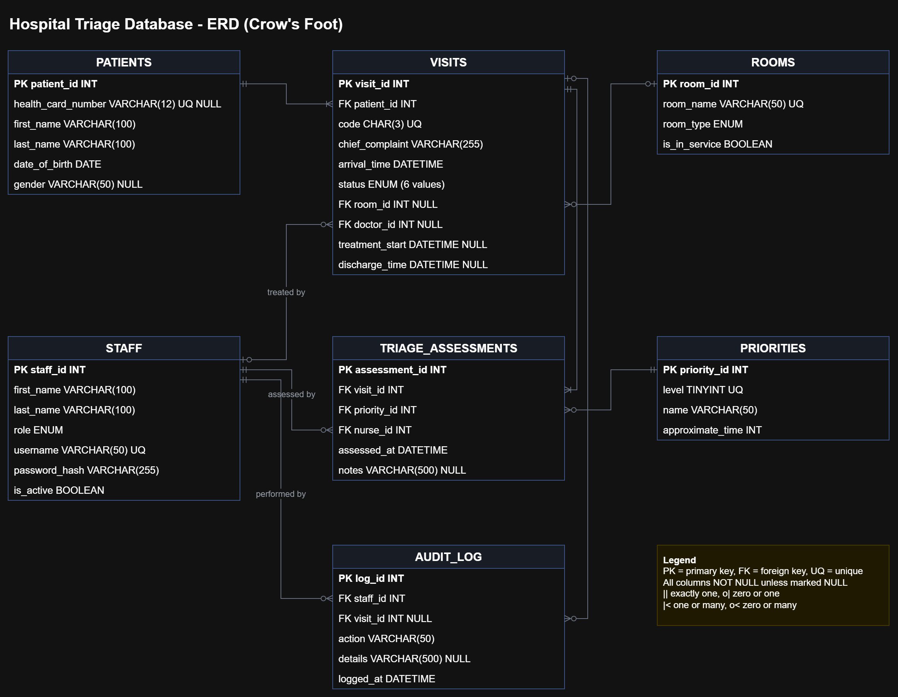

# Lab 11: Hospital Triage Database Design

This document describes the relational database behind the Hospital Triage App (Assignment 3). Triage staff use the app to rank emergency room patients by **severity** and **time already waiting**, and patients sign in with their **last name and a 3-letter code** to see an approximate wait time.

- **DBMS:** MySQL
- **Notation:** Crow's Foot ERD

---

## 1. Entities

| Entity | Description |
| --- | --- |
| **PATIENTS** | A person who has come to the emergency room. Stores identity details that stay the same from visit to visit. |
| **VISITS** | One trip to the emergency room by a patient (an "encounter"). Holds the sign-in code, arrival time, status, room and treating doctor. This is the central table of the system. |
| **TRIAGE_ASSESSMENTS** | Every severity assessment made during a visit, at check-in and at any later re-triage. The most recent assessment gives the visit's current priority. |
| **PRIORITIES** | Lookup table of the five CTAS (Canadian Triage and Acuity Scale) levels and their target wait times. |
| **ROOMS** | Treatment rooms in the emergency department. |
| **STAFF** | Hospital staff who log in to the app: doctors, triage nurses and administrators. |
| **AUDIT_LOG** | A record of every action staff take in the app (viewing a record, changing a status, assigning a room), for accountability and health-privacy compliance. |

---

## 2. Attributes

All columns are `NOT NULL` unless marked `NULL`.

### PATIENTS

| Column | Data type | Constraints | Description |
| --- | --- | --- | --- |
| patient_id | INT | PRIMARY KEY, AUTO_INCREMENT | Unique patient identifier |
| health_card_number | VARCHAR(12) | UNIQUE, NULL | Health card number with version code. Nullable for visitors and uninsured patients |
| first_name | VARCHAR(100) | | Patient's first name |
| last_name | VARCHAR(100) | | Patient's last name (used for sign-in) |
| date_of_birth | DATE | | Used to calculate age |
| gender | VARCHAR(50) | NULL | Optional, free text |

### VISITS

| Column | Data type | Constraints | Description |
| --- | --- | --- | --- |
| visit_id | INT | PRIMARY KEY, AUTO_INCREMENT | Unique visit identifier |
| patient_id | INT | FOREIGN KEY -> PATIENTS(patient_id) | The patient this visit belongs to |
| code | CHAR(3) | UNIQUE, CHECK (exactly 3 uppercase letters) | Sign-in code given to the patient |
| chief_complaint | VARCHAR(255) | | Main reason for the visit |
| arrival_time | DATETIME | DEFAULT CURRENT_TIMESTAMP | When the patient checked in; starts the queue clock |
| status | ENUM('waiting', 'in_treatment', 'discharged', 'admitted', 'transferred', 'left_without_being_seen') | DEFAULT 'waiting' | Where the visit stands. Only `waiting` visits are in the queue. The last four values record how the visit ended (disposition) |
| room_id | INT | FOREIGN KEY -> ROOMS(room_id), NULL | Room the patient is placed in. Empty while waiting |
| doctor_id | INT | FOREIGN KEY -> STAFF(staff_id), NULL | Doctor treating the patient. Empty while waiting |
| treatment_start | DATETIME | NULL | When the patient left the queue |
| discharge_time | DATETIME | NULL | When the visit ended |

### TRIAGE_ASSESSMENTS

| Column | Data type | Constraints | Description |
| --- | --- | --- | --- |
| assessment_id | INT | PRIMARY KEY, AUTO_INCREMENT | Unique assessment identifier |
| visit_id | INT | FOREIGN KEY -> VISITS(visit_id) | Visit being assessed |
| priority_id | INT | FOREIGN KEY -> PRIORITIES(priority_id) | Severity level assigned |
| nurse_id | INT | FOREIGN KEY -> STAFF(staff_id) | Staff member who made the assessment |
| assessed_at | DATETIME | DEFAULT CURRENT_TIMESTAMP | When the assessment was made |
| notes | VARCHAR(500) | NULL | Reason for the level, or for a change of level |

### PRIORITIES

| Column | Data type | Constraints | Description |
| --- | --- | --- | --- |
| priority_id | INT | PRIMARY KEY, AUTO_INCREMENT | Unique identifier |
| level | TINYINT | UNIQUE, CHECK (level BETWEEN 1 AND 5) | CTAS level, 1 being most severe |
| name | VARCHAR(50) | | Resuscitation, Emergent, Urgent, Less Urgent, Non-Urgent |
| approximate_time | INT | | Target wait time in minutes (0, 15, 30, 60, 120) |

### ROOMS

| Column | Data type | Constraints | Description |
| --- | --- | --- | --- |
| room_id | INT | PRIMARY KEY, AUTO_INCREMENT | Unique room identifier |
| room_name | VARCHAR(50) | UNIQUE | Display name, e.g. "Exam 3" |
| room_type | ENUM('resuscitation', 'trauma', 'exam') | | Kind of patients the room can take |
| is_in_service | BOOLEAN | DEFAULT TRUE | FALSE while the room is being cleaned or repaired |

### STAFF

| Column | Data type | Constraints | Description |
| --- | --- | --- | --- |
| staff_id | INT | PRIMARY KEY, AUTO_INCREMENT | Unique staff identifier |
| first_name | VARCHAR(100) | | |
| last_name | VARCHAR(100) | | |
| role | ENUM('doctor', 'triage_nurse', 'admin') | | Controls what the staff member can see and do in the app |
| username | VARCHAR(50) | UNIQUE | Login name |
| password_hash | VARCHAR(255) | | Hash of the password. Plain passwords are never stored |
| is_active | BOOLEAN | DEFAULT TRUE | Staff who leave are deactivated, not deleted, so history stays intact |

### AUDIT_LOG

| Column | Data type | Constraints | Description |
| --- | --- | --- | --- |
| log_id | INT | PRIMARY KEY, AUTO_INCREMENT | Unique log entry identifier |
| staff_id | INT | FOREIGN KEY -> STAFF(staff_id) | Staff member who performed the action |
| visit_id | INT | FOREIGN KEY -> VISITS(visit_id), NULL | Visit affected. NULL for actions not tied to a visit, such as logging in |
| action | VARCHAR(50) | | e.g. LOGIN, VIEW_VISIT, UPDATE_STATUS, ASSIGN_ROOM |
| details | VARCHAR(500) | NULL | Extra context, e.g. "status: waiting -> in_treatment" |
| logged_at | DATETIME | DEFAULT CURRENT_TIMESTAMP | When the action happened |

---

## 3. Relationships

| Relationship | Cardinality | Foreign key | Meaning |
| --- | --- | --- | --- |
| PATIENTS to VISITS | 1 : N (one or many) | VISITS.patient_id | A patient has one or more visits. Each visit belongs to exactly one patient |
| VISITS to TRIAGE_ASSESSMENTS | 1 : N (one or many) | TRIAGE_ASSESSMENTS.visit_id | Every visit is assessed at least once at check-in, and again whenever it is re-triaged |
| PRIORITIES to TRIAGE_ASSESSMENTS | 1 : N (zero or many) | TRIAGE_ASSESSMENTS.priority_id | Each assessment assigns exactly one priority level |
| STAFF to TRIAGE_ASSESSMENTS | 1 : N (zero or many) | TRIAGE_ASSESSMENTS.nurse_id | Each assessment is made by exactly one staff member ("assessed by") |
| STAFF to VISITS | 0..1 : N | VISITS.doctor_id | A visit is treated by zero or one doctor ("treated by") |
| ROOMS to VISITS | 0..1 : N | VISITS.room_id | A visit uses zero or one room. A room hosts many visits over time |
| STAFF to AUDIT_LOG | 1 : N (zero or many) | AUDIT_LOG.staff_id | Every log entry records which staff member acted ("performed by") |
| VISITS to AUDIT_LOG | 0..1 : N | AUDIT_LOG.visit_id | A log entry may concern one visit |

### Resolving a many-to-many relationship

Over the course of a visit, VISITS and PRIORITIES are many-to-many: a visit can have several priorities over time (re-triage), and a priority level applies to many visits. A relational database cannot store an M:N relationship directly, so **TRIAGE_ASSESSMENTS acts as a junction (associative) table**. It splits the M:N into two 1:N relationships and stores data about the relationship itself (when, by whom, and why).

### STAFF in two roles

STAFF is linked to VISITS (as the treating doctor) and to TRIAGE_ASSESSMENTS (as the assessing nurse) through two separate foreign keys. That is why the diagram shows two separate lines from STAFF.

### Delete behaviour

Every foreign key uses `ON DELETE RESTRICT`. Medical and audit records must never disappear because a related row was deleted. Staff are deactivated with `is_active` instead of being deleted.

---

## 4. Derived values

| Value | How it is calculated | Why it is not stored |
| --- | --- | --- |
| Current priority | The TRIAGE_ASSESSMENTS row with the latest `assessed_at` for the visit | A stored copy would duplicate the latest assessment and could fall out of sync |
| Wait time | Current priority, `arrival_time`, and the waiting patients ahead in the queue | Changes every time another patient is treated |
| Queue order | `status = 'waiting'`, ordered by current priority level, then `arrival_time` | Same reason as wait time |
| Room occupied | Whether a visit with `status = 'in_treatment'` uses that room | A stored flag could disagree with the actual visits |
| Patient age | Calculated from `date_of_birth` | Changes every year |

---

## 5. Design decisions

- **Patients and visits are separate tables.** A returning patient keeps one PATIENTS row, and each trip to the ER is a new VISITS row. This avoids duplicating personal details.
- **CTAS levels** are used for priorities because CTAS is the standard triage scale in Canadian emergency departments.
- **One STAFF table with a role**, instead of separate doctor and admin tables, avoids repeating identical columns and gives every staff member one login.
- **Triage history is kept** in TRIAGE_ASSESSMENTS so staff can see how a patient's severity changed and who changed it.
- **An audit log** records who accessed or changed patient data. Ontario's health privacy law (PHIPA) expects this kind of accountability.

### Normalization

- **First normal form (1NF):** Every column holds a single value. Names are split into first and last name, and multiple assessments are stored as separate rows, not as a list in one column.
- **Second and third normal form (2NF/3NF):** Every non-key column depends only on its own table's primary key. Priority names live only in PRIORITIES, staff names only in STAFF, and personal details only in PATIENTS, so each fact is stored in exactly one place.

---
